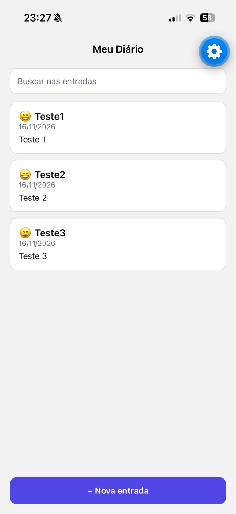
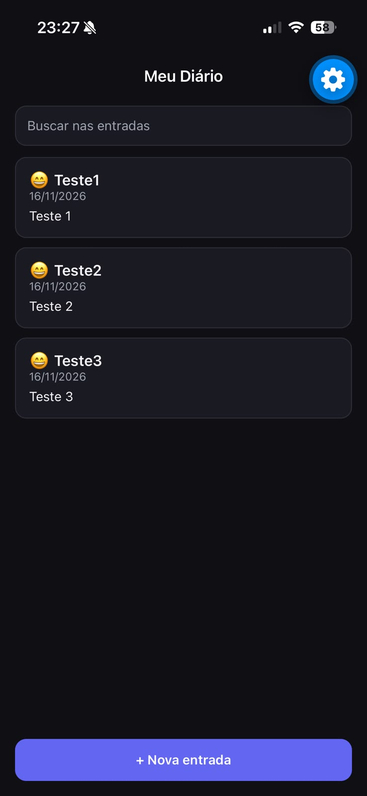
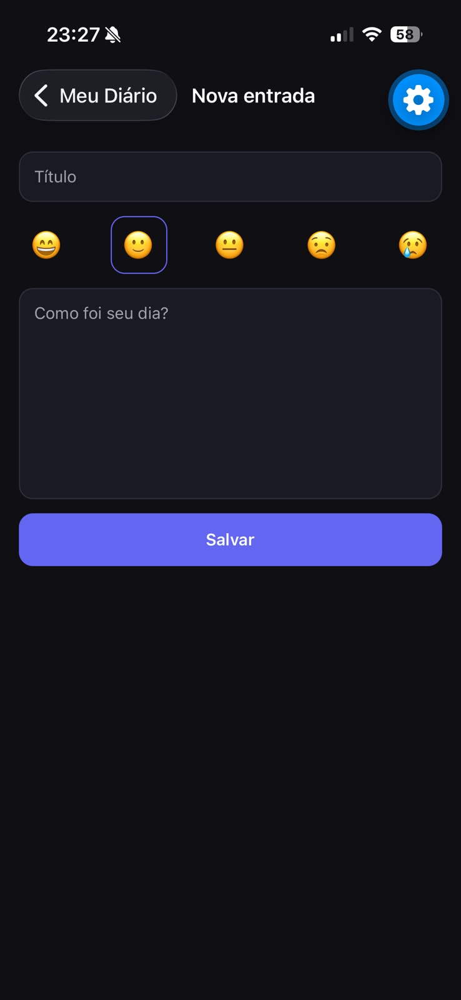
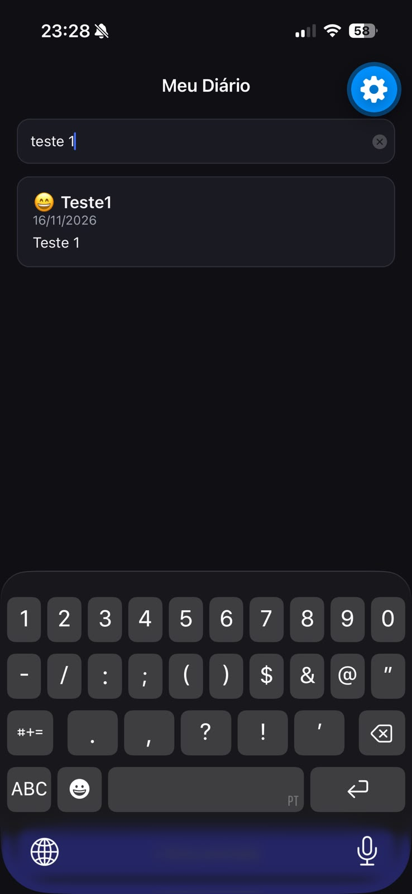
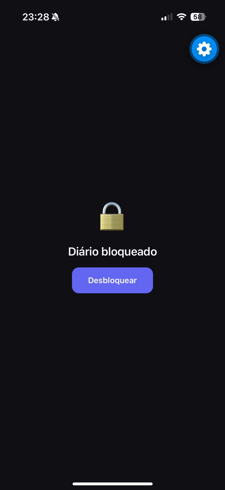

# Meu Diário

Aplicativo mobile de diário pessoal feito com React Native e Expo. Os dados ficam **somente no aparelho**, protegidos por **bloqueio biométrico** e **criptografia AES-256-GCM**.

| Lista (claro) | Lista (escuro) | Nova entrada | Busca | Bloqueio |
|---|---|---|---|---|
|  |  |  |  |  |

## Funcionalidades

- Criar, visualizar, editar e apagar entradas (título, texto e humor)
- Busca por título e texto, ignorando maiúsculas e acentos
- Bloqueio do app com biometria ou código do aparelho, ao abrir e ao voltar do segundo plano
- Criptografia do conteúdo das entradas antes de salvar no banco
- Tema claro e escuro automáticos, seguindo o aparelho
- Funcionamento 100% offline

## Tecnologias

- [React Native](https://reactnative.dev/) + [Expo](https://expo.dev/) com [Expo Router](https://docs.expo.dev/router/introduction/)
- TypeScript
- `expo-sqlite` para o armazenamento local
- `expo-local-authentication` para a biometria
- `expo-secure-store` e `expo-crypto` para a chave de criptografia
- `@noble/ciphers` para o AES-256-GCM

## Segurança

- **Criptografia em repouso:** título e texto são cifrados com AES-256-GCM antes de gravar no SQLite. O GCM é autenticado, então adulterações no conteúdo são detectadas
- **Nonce único:** um nonce aleatório de 12 bytes é gerado a cada criptografia
- **Gerenciamento da chave:** a chave de 256 bits é gerada na primeira execução e guardada no Keychain (iOS) ou Keystore (Android), fora do banco de dados
- **Bloqueio de acesso:** o app só abre depois de autenticar com a biometria ou o código do aparelho
- **Biblioteca auditada:** a criptografia usa `@noble/ciphers`, sem implementação própria
- **Queries parametrizadas:** todas as consultas SQL usam parâmetros, evitando injeção de SQL

### Limitações conhecidas

- A chave está protegida pelo sistema operacional, mas não é amarrada à biometria; quem controla o acesso ao app é a tela de bloqueio
- Se o app for desinstalado e a chave se perder, as entradas cifradas não podem ser recuperadas
- Não há backup nem exportação dos dados no momento
- A busca é feita em memória, depois da descriptografia (uma busca em SQL não funcionaria com os dados cifrados). Para um diário pessoal o volume é pequeno, mas não escalaria para milhares de entradas

## Como rodar

Pré-requisitos: [Node.js](https://nodejs.org/) (LTS) e o app **Expo Go** no celular.

```bash
git clone https://github.com/fillxpi/AppDiario.git
cd AppDiario
npm install
npx expo start
```

Escaneie o QR code com o Expo Go (celular e computador na mesma rede Wi-Fi).

## Estrutura do projeto

```
src/
  app/          # telas e rotas (Expo Router)
  components/   # componentes reutilizáveis
  constants/    # paleta de cores
  db/           # acesso ao SQLite
  hooks/        # useBloqueio, useCores
  utils/        # criptografia
```

## Status e roadmap

O app foi desenvolvido e testado em iPhone, via Expo Go.

- [x] CRUD de entradas
- [x] Busca
- [x] Bloqueio biométrico
- [x] Criptografia das entradas
- [x] Modo escuro
- [x] Ícone e splash screen
- [x] Configuração do EAS Build
- [ ] Build iOS instalável (requer Apple Developer Program)
- [ ] Testes em dispositivo Android
- [ ] Exportação e backup das entradas
- [ ] Lembrete diário
